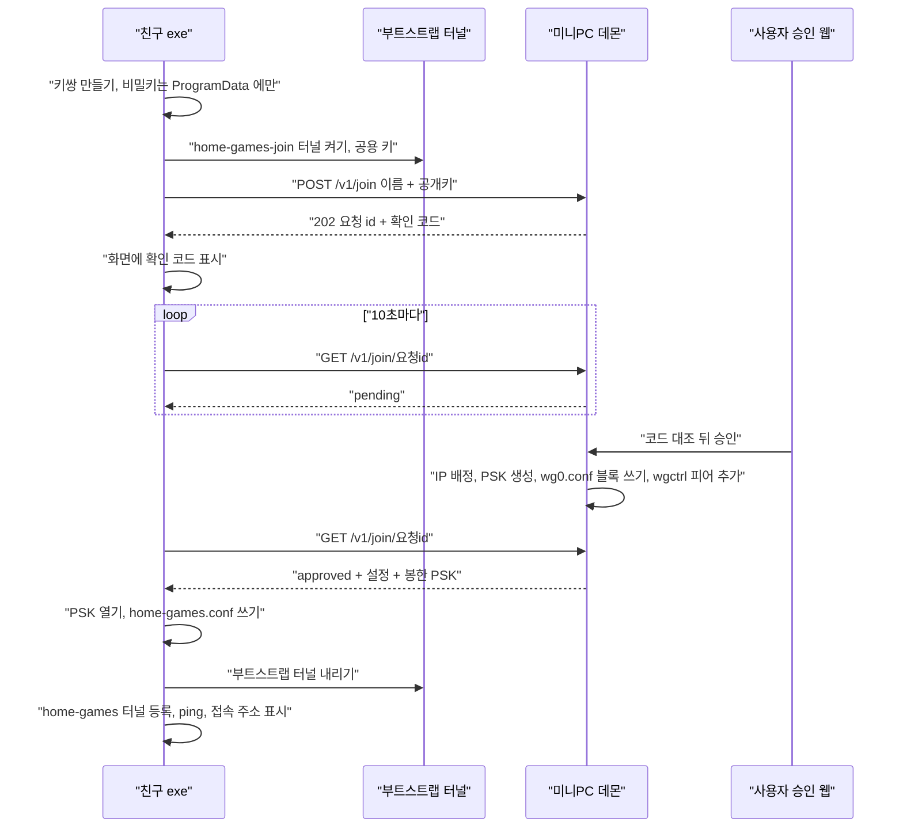

# 승인형 가입 설계 (AccessTool 1차)

설계일 : 2026-11-04 · 상태 : 구현 끝 (데몬·설치·친구 exe 1판 2026-11-04 · ① 격리 실측 통과 11-07 · 관리 API 11-07 · hosts 기능 뺌 11-08, 친구 실가입 전) · 기계 : 미니PC (Ubuntu 26.04, `wg0` 10.183.26.1/24, UDP 51820) ·
이어받는 설계 : 이전에 쓰던 wg-friend 스크립트 설계(비공개, 이 저장소에 없다. 본문의 「옛 설계」·「옛 `INSTALL.bat`」 은 그것을 말한다)

> 친구는 **exe 하나를 실행하고 이름만 넣는다.** exe 가 친구 PC 에서 키를 만들고, 「부트스트랩 터널」로 미니PC 에 가입을 요청한다.
> 사용자는 **LAN 의 승인 웹**에서 확인 코드를 보고 승인한다. 그러면 exe 가 진짜 터널로 갈아탄다.
> 친구 비밀키는 친구 PC 밖으로 안 나간다. zip·DM 으로 키를 넘기는 단계가 없어진다.
>
> 핵심 결정 넷 : ① 피어는 **wg0.conf 에 옛 `wg-friend` 와 같은 꼴로 쓴다** ② 부트스트랩 격리는 **nftables 전용 표(버리기만)** ③ 승인 웹은 **LAN + 토큰 + 메인 PC 만 허용**
> ④ PSK 는 **친구 공개키로 봉해서** 보낸다 (부트스트랩 키가 공개라서 응답이 엿보일 수 있기 때문, 4장).

## 1. 지금 구성 (실측 2026-11-04, 그대로 이어받는다)

| 항목 | 값 | 이 설계에서 |
| --- | --- | --- |
| 서버 | `wg-quick@wg0`, `/etc/wireguard/` 는 root 700, `wg0.conf` root 600, `SaveConfig = false` | 그대로. 권한만 설치 때 한 번 넓힌다 (3-1) |
| 피어 기록 꼴 | `# BEGIN peer <이름>` … `# END peer <이름>` 블록, 피어마다 `PresharedKey` | **같은 꼴로 쓴다** — `wg-friend list/remove` 가 그대로 먹는다 |
| IP 배정 | `.2`~`.254` 중 가장 작은 빈 칸 (wg0.conf 의 `AllowedIPs` 를 읽음) | 같은 규칙. `.254` 는 부트스트랩이 차지 |
| 이름 규칙 | `^[a-z0-9][a-z0-9-]{0,19}$` | 같은 규칙. 서버·클라 둘 다 검사 |
| 잠금 | `/run/wg-friend.lock` 에 `flock` | **같은 파일을 같이 잡는다** — 동시에 돌아도 IP 가 안 겹친다 |
| 반영 | `systemctl reload wg-quick@wg0` (= wg0.conf 로 `syncconf`) | 데몬은 `wgctrl-go` 로 피어 하나만 더하고·뺀다. 파일에도 써 두므로 reload 해도 안 사라진다 |
| 친구 conf | `Address .N/32` · `AllowedIPs = 10.183.26.1/32` · `PersistentKeepalive = 25` · DNS 줄 없음 | 같은 꼴 |
| 친구 PC | 터널 `home-games`, conf `%ProgramData%\HomeGames\`, (옛 bat 은 hosts 한 줄), MSI 1.1.1 고정 + SHA256 | exe 가 그대로 한다 (`INSTALL.bat` 흡수). **hosts 는 안 고친다** — 접속 주소는 터널 서버 IP (12장) |
| ufw | INPUT 기본 DROP, `ufw allow in on wg0 to any port <포트>` (게임마다 `game-enable.sh`) | 친구마다 규칙 없음 (인터페이스 단위라 새 친구도 자동). 부트스트랩만 따로 막는다 |
| 미니PC 에 Go | 없음 | 메인 PC 에서 `GOOS=linux` 로 빌드해 올린다 |
| 빈 포트 | `ss -ltn` 에 7480·7481 없음 | 접수 API `10.183.26.1:7480/tcp`, 승인 웹 `192.168.1.10:7481/tcp` (제안값. 이 문서의 LAN IP 는 예시 — 미니PC `192.168.1.10` · 메인 PC `192.168.1.20` · 공유기 `192.168.1.1`) |

## 2. 전체 흐름



- **확인 코드** : 공개키 SHA-256 앞 6자리(base32). 친구 exe 화면과 승인 웹에 같은 값이 뜬다. 친구가 디스코드로 코드를 알려 주고, 사용자는 **코드가 같을 때만** 승인한다.
  부트스트랩 키는 사실상 공개라 아무나 「철수」 이름으로 요청을 넣을 수 있다. 코드 대조가 그걸 거른다.
- exe 를 닫았다 다시 켜도 같은 키·같은 요청 id 로 폴링을 이어 간다 (상태는 `%ProgramData%\HomeGames\join.json`).

## 3. 부품 셋

### 3-1. 미니PC 데몬 `accessd` (Go, linux/amd64)

| 책임 | 입력 | 출력 |
| --- | --- | --- |
| 접수 API | wg0 위 `10.183.26.1:7480` 의 HTTP. 출발지가 부트스트랩 IP(`.254`)가 아니면 403 | 요청 저장 `/var/lib/accesstool/requests.json` |
| 승인 웹 | `192.168.1.10:7481` 의 HTTP. 토큰 쿠키 | 요청 목록 · 승인 · 거절 · 피어 목록(핸드셰이크) · 회수 |
| 피어 추가·제거 | 승인·회수 | wg0.conf 블록 쓰기/빼기 + `wgctrl` `ConfigureDevice` (그 피어만, `ReplacePeers=false`) |
| 상태 정리 | 1분 타이머 | pending 24시간·approved 결과 7일 지나면 지움 |

- **실행 계정** : 전용 시스템 계정 `accesstool`. systemd `AmbientCapabilities=CAP_NET_ADMIN` · `CapabilityBoundingSet=CAP_NET_ADMIN` · `NoNewPrivileges=yes` ·
  `ProtectSystem=strict` · `ReadWritePaths=/etc/wireguard /var/lib/accesstool /run/wg-friend.lock` · `ProtectHome=yes` · `After=`·`BindsTo=wg-quick@wg0.service` (wg0 가 없으면 7480 에 못 묶는다).
- **wg0.conf 쓰기 권한** (설치 스크립트가 한 번) : `/etc/wireguard` 를 `root:accesstool 710`, `wg0.conf` 를 `root:accesstool 660`. `server.key` 는 600 그대로.
  디렉터리 쓰기 권한이 없으므로 **제자리 덮어쓰기**(전체 내용 한 번에 write + fsync)이고, 직전 판은 `/var/lib/accesstool/wg0.conf.bak` 에 남긴다.
  `ReadWritePaths` 에 파일 대신 폴더를 주는 까닭 : 파일 하나를 묶으면 그 inode 에 붙어, vim·`sed -i` 로 갈아 끼운 새 wg0.conf 를 데몬이 못 본다.
  위험은 넓어진다 — wg0.conf 쓰기는 곧 root 다 (5장).
- **잠금** : tmpfiles.d 로 `/run/wg-friend.lock` 을 `root:accesstool 0660` 으로 미리 만든다. 데몬은 `syscall.Flock` 으로 같은 파일을 잡는다. `wg-friend` 는 고치지 않는다.
- **MPTCP 끄기** : 두 리스너 모두 `net.ListenConfig{}` 에 `SetMultipathTCP(false)` 를 부른 뒤 `Listen`. 까닭으로 받은 CVE-2026-98432 는 이 문서에서 원문 확인 못 함 (Go 1.24 부터 리스너 MPTCP 가 기본으로 켜진다는 점 자체는 끌 까닭으로 충분하다).
- **HTTP 만, TLS 없음** : 접수 API 는 WireGuard 안이라 이미 암호화된다. 승인 웹은 LAN 평문 — 토큰이 LAN 에서 보일 수 있다는 한계는 7장.
- 피어 이름 앞에 표시를 붙이지 않는다. 대신 블록에 `# by accesstool <시각>` 주석 한 줄을 더한다 (wg-friend 의 awk 는 이 줄을 무시한다 — 구현 때 호환 시험으로 확인).

### 3-2. 친구 exe `homegames-join.exe` (Go, windows/amd64, 서명 없음)

순서 (각 단계는 다시 실행해도 안전해야 한다) :

| # | 하는 일 | 실패하면 |
| --- | --- | --- |
| 1 | 시작하자마자 관리자인지 본다(`wgwin.IsAdmin` = 토큰 `IsElevated`). 아니면 자신을 `runas` 로 다시 띄운다(UAC 한 번, `wgwin.RelaunchAsAdmin`). 매니페스트는 안 쓴다. 관리자가 필요한 자리 : MSI 설치 · `/installtunnelservice` · `%ProgramData%` ACL | 「'예' 를 눌러야 합니다」 |
| 2 | 이미 `WireGuardTunnel$home-games` 가 RUNNING 이고 `10.183.26.1` ping 이 되면 「이미 연결됨」 끝. `--rejoin` 이면 계속 | — |
| 3 | WireGuard 없으면 MSI 1.1.1 내려받기 → SHA256 대조 → `msiexec /qn DO_NOT_LAUNCH=1` (옛 `INSTALL.bat` 과 같은 값) | 「인터넷 확인」 / 「파일 손상」 |
| 4 | `join.json` 이 없으면 이름 묻기(정규식 검사) · `wgtypes.GeneratePrivateKey()` · 비밀키를 `%ProgramData%\HomeGames\` 에 SYSTEM·Administrators 만 읽게 저장 | — |
| 5 | 부트스트랩 conf (`Address 10.183.26.254/32`, `AllowedIPs 10.183.26.1/32`, 키·Endpoint·서버 공개키는 exe 옆 `join.conf` 에서 읽음) → 터널 `home-games-join` 등록 | 「등록 실패, 화면 찍어 보내기」 |
| 6 | `POST /v1/join` → 확인 코드를 크게 표시 → 10초마다 폴링. 창을 닫아도 됨 (다시 켜면 6부터) | 이름 중복이면 4로 돌아가 다른 이름 |
| 7 | approved → PSK 열기 → `home-games.conf` 쓰기(ACL) → `home-games-join` 내리기 → 옛 `home-games` 있으면 내리기 → 새로 등록 → ping → 게임 접속 주소(터널 서버 IP `10.183.26.1`) 표시 | 실패 칸은 옛 `INSTALL.bat` 4장 표와 같은 문구 |
| 8 | rejected·expired → `home-games-join` 내리고 키·`join.json` 지움 | 「서버장에게 물어보세요」 |

- 두 터널 모두 `AllowedIPs 10.183.26.1/32` 라 동시에 켜면 경로가 겹친다. 그래서 7 에서 **반드시 부트스트랩을 먼저 내린다.**
- 부트스트랩 비밀키·Endpoint·서버 공개키는 **exe 옆 설정 파일 `join.conf`** 에서 읽는다 (빌드 때 박지 않는다 — 사용자 확정 2026-11-04).
  꼴은 `key = value` 줄 : `bootstrap_private_key` · `endpoint` · `server_public_key` · `server_ip`(기본 10.183.26.1) · `intake_port`(기본 7480).
  까닭 : 공개 저장소에 비밀값이 안 들어가고 exe 가 범용이 된다. `install.sh` 가 `/var/lib/accesstool/join.conf` 에 써 준다.

### 3-3. 설치

| 무엇 | 누가 | 내용 |
| --- | --- | --- |
| `deploy/install.sh` | 사용자 `sudo` 한 번 | 계정 `accesstool` · 권한 변경(3-1) · tmpfiles · nft 표(oneshot 유닛 `accesstool-nft.service` 가 부팅 때 wg0 보다 먼저 올린다) · ufw 접수 규칙 · 승인 웹 ufw 규칙 · 부트스트랩 블록을 wg0.conf 에 넣고 reload · 유닛 enable · 토큰 파일 `/var/lib/accesstool/web.token` 만들어 화면에 한 번 찍기 · 친구용 `join.conf` 쓰기 |
| 데몬 판올림 | 사용자 `sudo` (AI 계정은 sudo 불가) | 같은 스크립트를 다시 돌리면 바이너리만 바꾸고 재시작. 있는 키·토큰·요청은 안 덮는다 |
| 친구 exe | AI 빌드 → 사용자가 디스코드로 배포 | **exe + `join.conf` 를 zip 하나로** 준다. 서명 없음. MSI 는 exe 가 내려받는다 (결정 표) |

## 4. 프로토콜 (접수 API, `http://10.183.26.1:7480`)

```json
POST /v1/join            // 본문 1KB 까지
{ "name": "chulsoo", "pubkey": "<base64 32바이트>", "client": "homegames-join/0.1" }

202 { "id": "<무작위 128비트 hex>", "code": "K7Q2MX", "poll_after": 10 }
409 { "error": "name_taken" }      // 이름이 wg0.conf 나 대기 목록에 있음
409 { "error": "pubkey_taken" }    // 이미 등록된 피어의 공개키
429 { "error": "busy", "retry_after": 60 }
```

- 같은 `pubkey` 로 다시 POST 하면 **같은 id 를 돌려준다** (exe 재실행에 안전).

```json
GET /v1/join/<id>
200 { "state": "pending" }
200 { "state": "rejected" }   // 또는 "expired"
200 { "state": "approved",
      "config": { "address": "10.183.26.7/32", "server_pubkey": "<base64>",
                  "endpoint": "<DDNS 이름>:51820", "allowed_ips": ["10.183.26.1/32"],
                  "keepalive": 25, "psk_sealed": "<base64>" } }
404                            // 모르는 id
```

- **PSK 를 봉하는 까닭** : 부트스트랩 피어는 하나뿐이고 서버는 그 피어의 Endpoint 를 「마지막으로 맞는 패킷이 온 곳」으로 바꾼다.
  키를 가진 공격자가 핸드셰이크를 하면 그 순간 서버의 응답이 공격자 쪽으로 간다. 그래서 응답에 비밀이 있으면 안 된다.
  `psk_sealed` 는 NaCl sealed box(`x/crypto/nacl/box.SealAnonymous`)로 **친구 공개키(Curve25519)에 봉한 PSK** 다. 친구 비밀키로만 열린다. 나머지 칸은 비밀이 아니다.
- **폭주 제한** : 부트스트랩으로 오는 요청은 출발지가 전부 `.254` 하나라 IP 별 제한은 의미가 없다. **전체 단위**로 건다 —
  POST 분당 10건 · 대기 요청 최대 20건 · GET 초당 5건 · 연결 동시 16개 · 읽기 시간 제한 5초. 넘으면 429.
- 승인 전 요청은 wg 피어가 아니다. 파일에 줄 한 줄일 뿐 아무 권한이 없다.

## 5. 보안 경계

| 경계 | 무엇이 지키나 |
| --- | --- |
| 부트스트랩 → 접수 API 말고 다른 곳 | **nft 표 `inet accesstool`** (input 훅, 우선순위 -10) : `iifname "wg0" ip saddr 10.183.26.254` 이면서 `ip daddr 10.183.26.1 tcp dport 7480` 이 **아니면 drop**. 버리기만 하고 받기는 ufw 에 맡긴다 (nft 는 drop 이 최종이라 ufw 규칙 순서·`ufw reset` 과 상관없이 지켜진다) |
| 부트스트랩 → 접수 API | ufw `allow in on wg0 from 10.183.26.254 to 10.183.26.1 port 7480 proto tcp comment accesstool-intake` + 데몬의 출발지 검사 |
| 친구 → 접수 API | ufw 에 허용 없음 (출발지 `.254` 만) |
| 친구 → 친구·LAN | 옛 설계 그대로 : `ip_forward=0` · FORWARD DROP. 친구 `AllowedIPs` 는 친구가 고칠 수 있으므로 경계가 아니다 |
| 승인 웹 | 리스너는 미니PC LAN IP(`192.168.1.10`) 만 · ufw 는 메인 PC(`192.168.1.20`) 에서만 7481 허용 · 토큰 (6장 결정) |
| 데몬이 털리면 | 얻는 것 : `CAP_NET_ADMIN`(서버 비밀키 읽기·피어 조작), wg0.conf 쓰기. **wg0.conf 쓰기는 곧 root 다** — wg-quick 이 그 파일의 `PreUp`·`PostUp` 줄을 root 로 돌리므로 다음 wg0 재시작 때 넣은 명령이 root 로 돈다. 접수 API 입력으로는 그 줄을 못 넣는다 (이름은 정규식, 공개키는 정규 base64 만 받고, IP 는 데몬이 셈한다). 데몬 자체가 털려야 생기는 일이다 |
| 부트스트랩 키가 새면 | 원래 공개 전제. 할 수 있는 건 요청 넣기(코드 대조로 걸러짐)와 남의 응답 가로채기(비밀 없음). 바꾸려면 `install.sh --rotate-bootstrap` + 새 `join.conf` 다시 배포 (exe 는 그대로). 이미 가입한 친구는 영향 없음 |

## 6. 결정 표

| 항목 | 안 | 추천 | 근거 |
| --- | --- | --- | --- |
| 상태 저장 | A wg0.conf 에 같은 꼴로 직접 쓰기 · B 자체 JSON + 기동 때 재적용 | **A** | B 는 `wg-friend add` 의 `reload`(= syncconf)가 **JSON 피어를 지운다.** 재적용 훅을 따로 걸어야 하고 그 사이 친구가 끊긴다. A 는 재부팅·reload 에 그냥 남고 `wg-friend list/remove` 도 먹는다. 대가는 권한 넓히기(3-1) 하나 |
| 승인 웹 인증 | A LAN 만 · B LAN + 토큰 · C `127.0.0.1` 만 + SSH 터널 | **B** (+ ufw 로 메인 PC 만) | A 는 집 와이파이의 아무 기기나, 그리고 **사용자 브라우저가 연 아무 웹페이지가** 승인 POST 를 보낼 수 있다(CSRF). B : 토큰으로 한 번 로그인 → `HttpOnly; SameSite=Strict` 쿠키, POST 는 `Origin` 검사. C 가 가장 단단하지만 사용자가 매번 터널을 열어야 한다 |
| 부트스트랩 격리 | A ufw 규칙만 · B nft 전용 표 · C 전용 `wg1` + UDP 51821 | **B** | A 는 `game-enable.sh` 의 `allow in on wg0 to any port` 가 부트스트랩에도 먹어서 deny 를 맨 앞에 끼워야 하고, 순서가 깨지면 조용히 뚫린다. C 는 깔끔하지만 공유기 포워딩이 하나 늘고 「UDP 하나만 연다」 목표를 깬다 |
| 친구 클라이언트 | A 콘솔 exe 하나 · B 트레이 앱 · C bat + exe | **A** | 하는 일이 한 번뿐이다. 관리자는 매니페스트로 받으면 bat 이 필요 없다. 트레이는 상주할 까닭이 없다 |
| wg-friend 와 관계 | A 대체(지움) · B 공존 | **B** | 같은 파일·잠금·IP 규칙이라 공존 비용이 0 이다. exe 가 안 되는 친구용 수동 길로 남긴다. 기존 친구 피어도 그대로 |
| PSK | A 봉해서 보냄 · B PSK 안 씀 · C 터널 연결 뒤 진짜 터널로 받기 | **A** | 옛 설계가 「피어마다 PSK」를 정했다. B 는 그 결정을 뒤집는다. C 는 서버·클라가 PSK 를 동시에 바꿔야 해서 끊김 구간이 생긴다. A 는 `x/crypto` 한 함수 |
| 친구 설치 묶음 | A MSI 동봉 · B exe 가 내려받기(고정 판 + SHA256) | **B** | 옛 `INSTALL.bat` 에서 쓰던 길 그대로라 검증된 값이 있다. 배포물이 exe + `join.conf` zip 하나로 작다. 동봉은 다운로드 서버가 막힐 때만 이득 |
| 부트스트랩 값 넣는 곳 | A 빌드 때 `-ldflags -X` · B exe 옆 `join.conf` | **B** (사용자 확정 2026-11-04) | 공개 저장소·빌드 산출물에 비밀값이 안 들어간다. exe 하나로 서버가 바뀌어도 쓴다. 키를 바꿀 때 exe 를 다시 빌드하지 않는다. 서명은 하지 않는다 |
| 데몬 설치 | `install.sh` 를 사용자가 `sudo` 로 한 번 | — | AI 계정은 sudo 가 안 된다. 다시 돌려도 안전하게 짠다 |

## 7. 알려진 한계

- **동시에 두 명이 가입하면 꼬인다.** 부트스트랩 피어는 하나라 서버가 Endpoint 를 번갈아 바꾼다. HTTP 재시도로 대개 넘어가겠지만 보장은 없다 (추측). 「한 번에 한 명씩」 안내로 막는다.
- 승인 웹 토큰은 LAN 에서 평문으로 오간다. 메인 PC 한 대만 허용하므로 받아들인다.
- 서명 없는 exe 라 SmartScreen 「추가 정보 → 실행」 을 친구가 눌러야 한다. 백신이 「키를 만드는 exe」를 의심할 수 있다. hosts 를 고치던 판은 Windows Defender 가 실제로 잡아 그 기능을 뺐다 (12장).
- 친구에게 주는 `join.conf` 에 부트스트랩 비밀키가 들어 있다. 공개 전제라 괜찮지만, zip 이 「아무 데나 올려도 되는 파일」이 되지는 않는다 (요청 폭주 원천이 된다). exe 자체에는 비밀이 없다.

## 8. 소단계와 예상 공수 (구현 단계)

공수 어림 도구로 잡은 값 (2026-11-04). **L 칸은 새 코드라 실제보다 2.5배쯤 작게 나오곤 한다** — 그대로 믿지 않는다.

| 소단계 | 분류·크기 | 예상 | 범위 |
| --- | --- | --- | --- |
| 1. 데몬 — wg0.conf 읽기·쓰기 · IP 배정 · 잠금 | 구현 L | 13분 | 2~59분 |
| 2. 접수 API · 폭주 제한 · 요청 저장 | 구현 M | 5분 | ~25분 |
| 3. 승인 웹 · 토큰 · CSRF | 구현 M | 5분 | ~25분 |
| 4. systemd 유닛 · `install.sh` · nft 표 | 구현 M | 5분 | ~25분 |
| 5. 친구 exe | 구현 L | 13분 | 2~59분 |
| 6. 단위 시험 · wg-friend 호환 시험 | 구현 M | 5분 | ~25분 |
| 7. 코드 리뷰 | 검토 M | 6분 | 1~17분 |
| 8. 격리 실측 (9장 ①) | 실측 S | 5분 | ~38분 |
| 9. 친구 1명 실가입 | 실측 S | 5분 | ~38분 |
| 10. 문서 최신화 | 문서 S | 1분 | ~5분 |
| 합 | | 1시간 4분 | 9분~5시간 15분 |

사람 몫(별도) : `sudo bash install.sh` 5분 · 토큰으로 첫 로그인 · 친구와 코드 대조.

## 9. 검증 계획 (시험 자료는 `Test/`)

| # | 무엇 | 어떻게 | 통과 기준 |
| --- | --- | --- | --- |
| ① | **부트스트랩은 접수 API 말고 아무 데도 못 닿는다** | **집 LAN 방식** (사용자 2026-11-07 — 메인 PC 에 와이파이가 없어 핫스팟을 못 쓴다) : 메인 PC 는 집 LAN 그대로, 부트스트랩 conf 의 Endpoint 를 미니PC LAN 주소(예: `192.168.1.10:51820`)로 하고 그 conf 만 켠다(틀 `Test/bootstrap-lan.conf.example`). `Test/isolation-check.ps1` 로 (터널 대역 밖 주소는 스크립트가 알아서 건너뛴다) `10.183.26.1` 의 TCP 22·7481·게임 포트·웹 서비스 포트, UDP 게임 포트, ICMP, 다른 친구 IP 에 연결 시도. 첫 판은 `AllowedIPs 10.183.26.1/32`(친구 exe 와 같음 — 다른 친구 IP 칸은 터널을 안 타 의미 없음), 둘째 판은 `10.183.26.0/24` 로 넓혀 포워딩 차단까지 본다. `0.0.0.0/0` 은 메인 PC 인터넷이 끊겨 안 쓴다. 집 LAN 주소(예: `192.168.1.x`)는 LAN 으로 닿으므로 nft 규칙 읽기로 확인한다. 바깥(DDNS) 경로는 ⑦ 친구 실가입 때 확인 | 7480 만 열림, 나머지 전부 시간 초과. 미니PC `nft list table inet accesstool` 카운터가 늘어남 |
| ② | 호환 | Go 가 쓴 블록을 `wg-friend list/remove` 가 처리, `wg-friend add` 뒤 데몬이 다음 빈 칸을 고름, reload 뒤 데몬 피어가 남음. 가짜 `wg`·`systemctl` 로 메인 PC 에서 (옛 시험 방식) | 셋 다 통과 |
| ③ | 프로토콜 단위 시험 | 이름 정규식 · 같은 pubkey 재요청 → 같은 id · 이름 중복 409 · 폭주 429 · sealed box 왕복 · 만료 | `go test` 통과 |
| ④ | 승인 웹 | 토큰 없이 401 · 다른 `Origin` 의 POST 거부 · 메인 PC 아닌 LAN 기기에서 연결 안 됨 | 셋 다 |
| ⑤ | MPTCP | 미니PC `ss -lnM` 에 7480·7481 이 MPTCP 로 안 뜸 (`-t` 를 넣으면 일반 TCP 소켓도 보여 판정이 안 된다) | 안 뜸 |
| ⑥ | 재부팅 | 승인 1건 뒤 미니PC 재부팅 | 친구 피어 남음, 데몬 다시 뜸 |
| ⑦ | 친구 1명 실가입 | 컴퓨터 제일 잘 아는 친구. exe 받기 → 코드 대조 → 승인 → 게임 접속 → 친구 PC 재부팅 뒤 다시 접속 | 안내문 말고 도움 없이 끝남 |

①이 통과하기 전에는 exe 를 배포하지 않는다.

### 9-1. 실측 기록 (2026-11-07, 메인 PC 집 LAN 방식)

| # | 결과 | 근거 |
| --- | --- | --- |
| ① | **통과** | 첫 판(`/32`)·둘째 판(`/24`) 모두 `isolation-check.ps1 -LanMode` PASS — 7480 만 열림, 16칸 시간 초과. 둘째 판은 `route print` 에 `10.183.26.0/24 → 10.183.26.254 on-link` 확인(다른 친구 IP 가 터널을 탐). 두 판 뒤 nft 카운터 return 12패킷 · drop 35패킷 |
| ① 남은 칸 | 규칙 읽기로 통과 | 미니PC LAN 주소·공유기 주소는 LAN 으로 닿아 실측 못 함 — drop 줄에 목적지 조건이 없어 막힌다. 다른 친구 IP 패킷은 `ip_forward=0` 이라 커널이 input 훅 전에 버려 drop 카운터에 안 잡힐 수 있다(시간 초과로 막힘은 확인) |
| ④ | 둘 통과 · 하나 남음 | 토큰 없이 GET 401, 다른 `Origin` POST 403 (메인 PC curl). 「메인 PC 아닌 LAN 기기 연결 안 됨」은 아직 |
| ⑤ | **통과** | `ss -lnM` 0줄 |

- PASS 의 시간 초과가 nft 에서 났다는 근거는 drop 카운터(35)와 nft 훅 우선순위 -10(ufw 보다 먼저)이다 — 스크립트 혼자로는 nft·ufw 를 못 가른다. 부팅 뒤 표가 다시 뜨는지는 ⑥ 에서 본다.
- 11-07 판은 리뷰 반영 전 스크립트(`-LanMode`, 게임 UDP·다른 친구 IP 칸도 판정)로 돌렸다. 같은 날 고친 판(닫힌 UDP 9 판정 칸, ICMP 상태 코드)으로 둘째 판(`/24`) 터널에서 다시 돌려 PASS — 7480 만 열림, 판정 칸 9개(닫힌 UDP 9 포함) 전부 시간 초과, 참고 칸 8개, 미니PC LAN 주소·공유기 주소는 대역 밖이라 건너뜀, exit 0.
- ufw 와 nft 전용 표가 같이 돈다는 11장 추정도 ① 에서 확인됐다 (ufw 로 7480 이 열리고 nft 가 나머지를 버림).
- 바깥(DDNS) 경로는 ⑦ 친구 실가입 때 본다.

## 10. 관리 API (2026-11-07 추가)

다른 관리 도구가 승인 웹 대신 이 일을 하게 하는 JSON API 다. 승인 웹과 **같은 리스너·같은 토큰**을 쓴다. 승인 웹 화면은 비상용으로 남긴다.
코드는 `cmd/accessd/api.go`. 승인·거절·회수는 승인 웹과 같은 함수를 부른다.

| 요청 | 본문 | 성공 응답 |
| --- | --- | --- |
| `GET /api/state` | — | `{"ok":true, "pending":[{id,name,code,created}], "recent":[{id,name,code,state,decided}], "peers":[{name,ip,handshake_ago_s,source,bootstrap}], "peers_error":""}` |
| `POST /api/approve` | `{"id":".."}` | `{"ok":true}` |
| `POST /api/reject` | `{"id":".."}` | `{"ok":true}` |
| `POST /api/revoke` | `{"name":".."}` | `{"ok":true}` |

- `pending` 은 오래된 것부터, `recent` 는 최근 것부터 (화면과 같은 7일 범위). 시각은 RFC3339. `code` 는 화면 값 그대로.
- `state` 는 `approved|rejected|expired`. `source` 는 `accesstool|wg-friend`. `handshake_ago_s` 는 정수 초, 핸드셰이크가 없으면 `null`.
- 핸드셰이크를 못 읽으면 `peers` 는 채우고 `peers_error` 에 글을 넣는다.
- 실패는 `{"ok":false,"error":"<한국어 원문>"}` — 토큰 없음·틀림 401 · `Origin` 있음 403 · `Content-Type` 이 JSON 아님 415 · 빈 값·JSON 아님 400 · 본문 4KB 넘음 413 · 충돌(대기 중 아님·부트스트랩 회수) 409 · 그 밖 500.
- 응답 헤더 `Content-Type: application/json; charset=utf-8`, `Cache-Control: no-store`. 모르는 필드는 무시한다.

보안 판단 :

- **Bearer 토큰만 받는다.** 쿠키로는 `/api/` 를 못 쓴다. 그래서 브라우저가 쿠키를 자동으로 붙이는 CSRF 가 성립하지 않는다. 비교는 `subtle.ConstantTimeCompare`.
- **`Origin` 헤더가 있으면 거부한다.** 서버끼리 부르는 API 라 브라우저에서 올 일이 없다. 승인 웹의 「같은 Origin 만」 검사보다 좁다.
- **CORS 헤더를 안 준다.** 다른 사이트의 스크립트가 응답을 읽을 길이 없다.
- Host 검사(DNS 리바인딩 막기)는 그대로. 리스너·방화벽(메인 PC 한 대만 7481)도 그대로다. 그래서 API 를 부르는 도구도 그 허용된 기기에서 돌아야 한다.
- **토큰이 LAN 에서 평문 HTTP 로 오간다.** 집 LAN 이고 ufw 로 메인 PC 한 대만 열어 두어 받아들인 위험이다 (7장과 같음).

## 11. 못 정한 것

- **포트 번호 7480·7481** — 지금 비어 있는 것만 확인했다. 사용자가 다른 번호를 원하면 바꾼다.
- **승인 웹을 메인 PC 한 대로만 묶을지** — 휴대폰으로도 승인하고 싶으면 LAN 전체 + 토큰으로 넓힌다 (사용자 판단). 넓혀도 `web_listen` 에는 0.0.0.0 이 아니라 미니PC 의 구체적 LAN IP 를 적는다 — Host·Origin 검사가 그 값과 견준다.
- **CVE-2026-98432** — 원문을 이 문서에서 확인 못 했다. MPTCP 끄기는 까닭과 상관없이 한다.
- Ubuntu 26.04 의 ufw 백엔드가 iptables-nft 라서 nft 전용 표와 같이 돈다고 **추정**한다 — ①에서 확인.
- WireGuard Windows 앱이 서명 없는 exe 의 `/installtunnelservice` 호출을 막지 않는지 (옛 bat 은 됐다 — 같을 것으로 추정).
- 친구 이름 중복 때 자동으로 뒤에 숫자를 붙일지, 다시 묻게 할지 (지금 안 : 다시 묻는다).
- ~~공개 저장소로 뗄 때 부트스트랩 키 원본 파일 자리~~ → 정함 : 미니PC `/etc/accesstool/bootstrap.key`(root 600), 친구용 사본은 `/var/lib/accesstool/join.conf`(root 600). 저장소에는 없다.

## 12. hosts 기능을 뺀 까닭 (2026-11-08)

- 친구 exe 는 **hosts 를 고치지 않는다.** 가입이 끝나면 화면에 「게임 접속 주소: 10.183.26.1 (포트는 서버 안내대로)」를 띄우고, 친구는 게임에 그 숫자를 직접 친다.
- 까닭 : 원래는 `install.sh --host-name` 으로 이름을 주면 exe 가 hosts 에 한 줄을 넣었다. 그런데 **Windows Defender 가 hosts 를 쓰는 exe 를 악성으로 잡았다.** 서명 없는 exe 라 피할 길이 마땅치 않고, 이름 하나 얻자고 친구가 백신 예외를 걸게 할 수는 없다.
- 그래서 `join.conf` 의 `host_name` 키 · `install.sh` 의 `--host-name` · `wgwin.AppendHostsLine` 을 모두 지웠다. 옛 `join.conf` 에 `host_name` 줄이 있으면 exe 가 「모르는 키」로 멈춘다 — 새 `join.conf` 로 zip 을 다시 만든다.
- 이전 wg-friend 방식으로 붙은 친구는 이 코드와 상관없어 영향이 없다.
